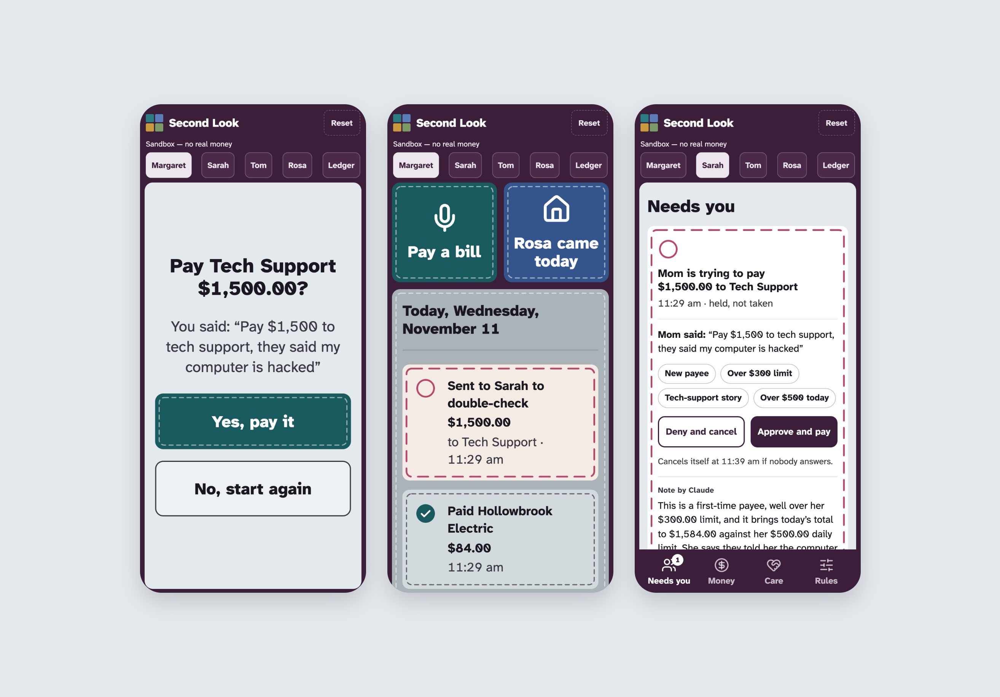
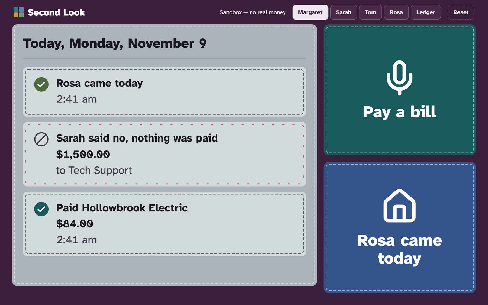
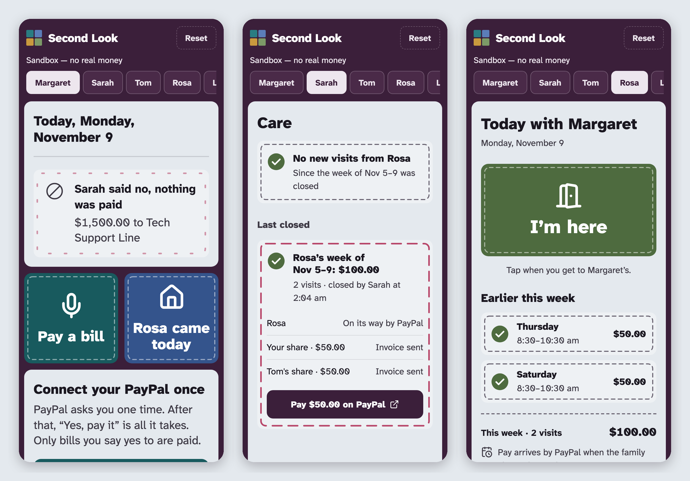
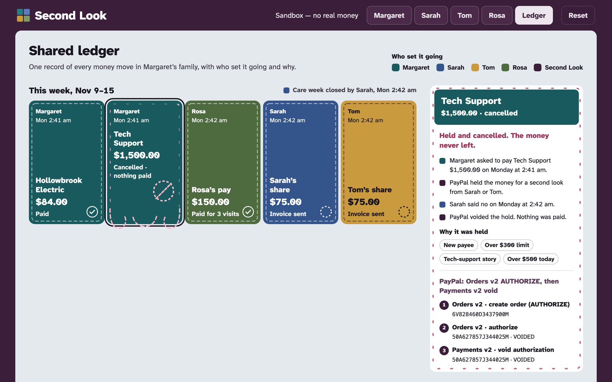
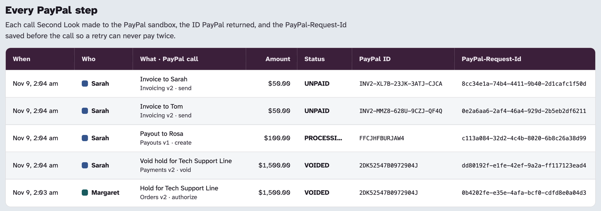
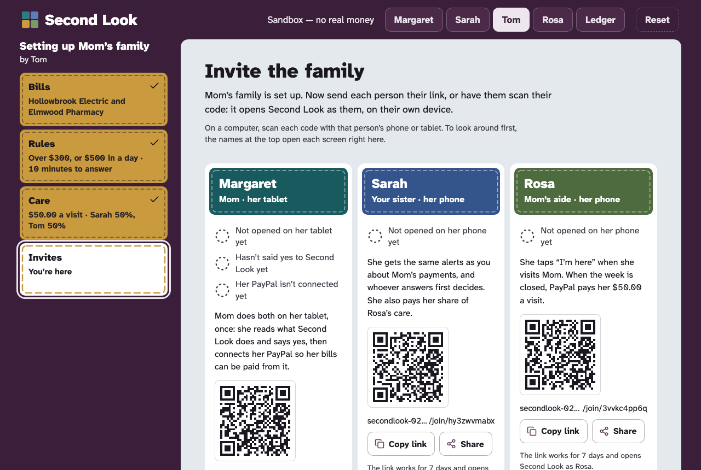
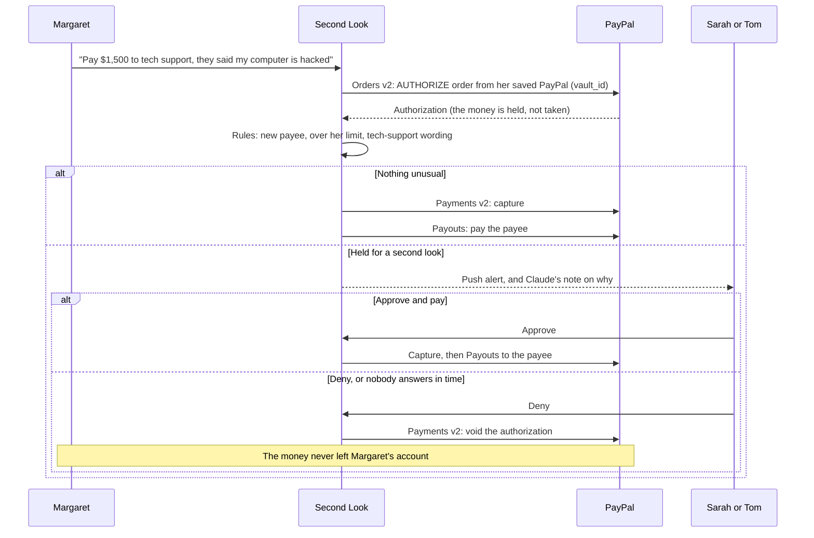
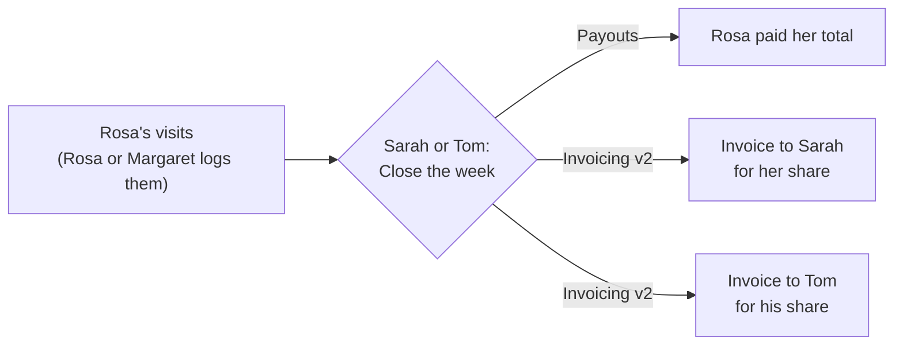
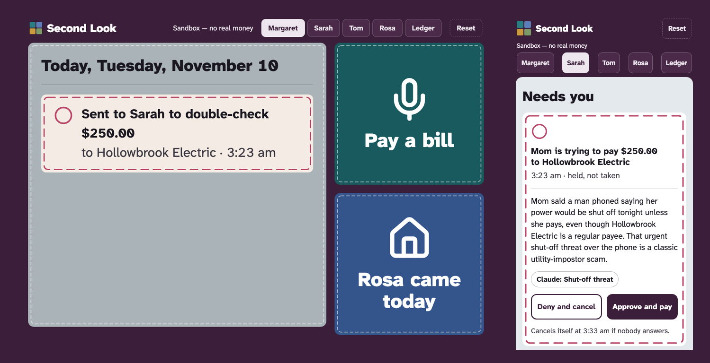
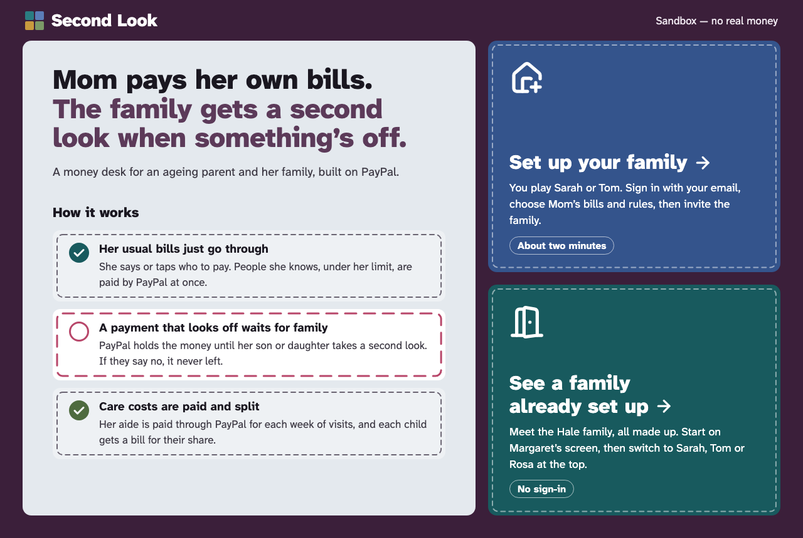

# Second Look

**Mom pays her own bills. The family gets a second look when something's off.**

Second Look is a family money desk for an ageing parent, built on PayPal. Margaret keeps paying her own bills, in her
own words. When a payment looks like a scam, it isn't refused and it isn't paid: PayPal **holds** it while her daughter or
son takes a second look. Deny, and the hold is voided: the money never left Mom's account. Care costs are handled in the
same place: the home aide is paid through PayPal Payouts, and the siblings are each invoiced for their share.

**[Live demo](https://secondlook-02u1.onrender.com)** · Video: _link added at submission_ · PayPal **sandbox** only: no
real money moves, and every person in it is fictional.



## The problem

Older adults are the first target of payment scams. In 2025 people over 60 filed more than **201,000** complaints with
the FBI's Internet Crime Complaint Center and reported more than **$7.7 billion** in losses
([FBI, citing the IC3 2025 report](https://www.fbi.gov/news/stories/scammers-target-older-adult-victims)). The script
is familiar: a caller says the computer is hacked and "tech support" needs $1,500 today.

Families are left with two bad options:

- **Take over her money.** It protects the savings, but it takes away her independence and tells her she can no longer
  be trusted, often years before that's true.
- **Hope for the best.** Bank alerts arrive after the money is gone, and a card block is a blunt refusal that leaves her
  embarrassed and still on the phone with the scammer.

Meanwhile the ordinary costs of care fall to the family too: a home aide paid each week, and siblings settling up their
shares through reminders, IOUs and awkward texts.

## What Second Look does

**Margaret pays her own bills.** She taps *Pay a bill*, says or types "Pay the electric bill, $84", hears it read back,
and says yes. She connected her PayPal once, so that's all it takes. Normal bills go straight through.



**Anything unusual is held, not refused.** A new payee, an amount over her limit or three times the usual, words like
"gift cards" or "hacked", urgency, or too much in one day: the payment is placed as a **PayPal authorization** and sent
to Sarah and Tom.

- Their phones buzz. They see what's unusual, explained in a sentence or two, with the facts the rules found.
- **Approve** captures the money and pays the payee. **Deny** voids the authorization. If nobody answers, the hold is
  voided automatically when its time runs out. The first answer wins, exactly once.
- Margaret's screen never says "scam" or shows a risk score. It says *"Sent to Sarah to double-check"*, then *"Sarah said
  no, nothing was paid."*

**Care costs are paid and split.** Rosa, the aide, taps *I'm here* and *Visit done* (or Margaret says "Rosa came
today"). When Sarah or Tom closes the week, Rosa is paid her total through PayPal Payouts, and each sibling gets a PayPal
invoice for their share, split to the cent.



**Everyone sees the same ledger.** Every money move is a block in the colour of the person who set it going: Margaret's
bills in teal, Rosa's pay in sage, each sibling's share in their colour. A cancelled hold keeps its pulled stitches.
Select a block to see the PayPal steps behind it, with every ID.



Under the quilt, **every PayPal step** Second Look made is listed with the ID PayPal returned and the `PayPal-Request-Id`
stored before the call.



## How a family sets it up

Say Tom is the son. He sets Second Look up with his mother, not over her head:

1. **He signs in with his email** (a link and a six-digit code) and says who he is.
2. **Mom's regular bills:** the electric company and the pharmacy, each with what it usually comes to. Known payees
   with usual amounts go straight through; anyone new gets a second look.
3. **What gets a second look:** her limit for one payment, her limit for a day, how far above its usual a regular
   bill may go, how long a held payment waits before it's cancelled, and whether he or both children are asked.
   Scam wording (tech support, gift cards, crypto or wire, the IRS, "don't tell anyone") always gets a second look.
4. **Care costs:** Rosa's rate per visit and how he and his sister split it.
5. **Invites:** one link or QR code each for Mom's tablet, his sister's phone and Rosa's phone. Each opens Second Look
   as that person, on their own device.

   

6. **On her tablet, Mom reads what it does in three plain sentences and says yes**, then connects her PayPal once.
   Nothing can be paid before she agrees.

   


Sarah and Tom can change any rule later on their **Rules** tab; it applies from Mom's next payment.

## How the money moves

Second Look is a pass-through: Margaret's money reaches the payee only through PayPal, and only after a capture.





| PayPal API | What it does here |
|---|---|
| Vault v3 | Margaret connects her PayPal once; later bills need no PayPal page |
| Orders v2 | An `AUTHORIZE` order for each bill, paid from her saved PayPal |
| Payments v2 | Capture on approval; void on deny or when a hold runs out |
| Payouts | Paying the payee of a bill; paying Rosa for her week |
| Invoicing v2 | One invoice per sibling for their share of the care week |
| Webhooks | Verified notifications for captures, voids, payouts and paid invoices |

Orders, Payments and Vault use the official **PayPal Server SDK** for TypeScript (`@paypal/paypal-server-sdk`); Payouts,
Invoicing and webhook verification call the REST API directly.

## Where AI is used

- **Claude's second opinion.** While Margaret's request is read back to her, Claude Sonnet 5.5 (`claude-sonnet-5-5`)
  reads her words and answers one question: do they tell a known scam story (a shut-off threat, a relative in trouble
  abroad, a prize to claim, an impostor bank...) in words the rules' lists would miss? If so, the payment is held like any
  other, with Claude's reading as a chip. *"Pay the electric bill, $250. A man from the power company called and said
  they'll shut off my power tonight if I don't pay"* is a known payee, under her limit and under 3× the usual: the rules
  alone would pay it. Claude holds it: *"Mom said a man phoned claiming the power company will shut off her electricity
  tonight unless she pays, which is a classic urgent shutoff-threat scam, even though the payee is her regular one."*
  **It can only add a hold, never remove one**: when the model is off, over its cap, slow (it gets four seconds after
  she says yes) or unsure, the rules alone decide, and her words are passed as quoted data, never as instructions.

  

- **Claude writes the note** Sarah and Tom read on a held payment, from the facts the rules (and the second opinion)
  found. For the $1,500 call above it wrote: *"This is a first-time payee, well over her $300.00
  limit, and Mom said someone told her the computer was hacked. That fits a common tech-support scam, where callers
  claim a problem and ask for payment."*
- The **rules decide** what's held, and Claude can add to them, never subtract. The note is written after Margaret has her answer,
  so she never waits on it. A plain template note is used if the model is off, over its cap, slow, or returns anything
  unexpected. Calls are capped per demo session and per day.
- **Speech recognition** in the browser turns what Margaret says into text on her own device.

## Built to be safe

- **Hold, don't refuse.** A flagged payment is an open PayPal authorization: nothing is taken until a family member
  approves, and denying voids it.
- **No payout before a capture**, and no capture of a held payment without a family member's approval.
- **Nothing pays twice.** Every PayPal POST carries a `PayPal-Request-Id` stored before the call; payouts use a fixed
  `sender_batch_id` and invoices a fixed invoice number. Retries, double taps and webhook redeliveries are safe.
- **Integer cents** everywhere; shares always add up to the total, with the leftover cent going to a fixed person.
- **Secrets stay on the server**; the app refuses to start unless `PAYPAL_ENV=sandbox`.
- **Each visitor gets an isolated demo family**; Reset clears only theirs.
- **Sign-in stores no email address**, only a keyed hash of it. Links and codes are hashed, work once, expire in 15
  minutes, and sending is capped per visitor, per address and per day.
- **Margaret is never shamed**: no scam words or risk scores on her screen.

## Try it

Open the [live demo](https://secondlook-02u1.onrender.com). The welcome page has two doors:




- **See a family already set up:** the Hale family, ready to use, no sign-in. Switch people with the tabs at the top.
- **Set up your family:** you play Sarah or Tom, sign in with your email and set the family up as above (about two
  minutes). On the invites step, *Use the demo's saved PayPal* stands in for Mom's PayPal login.

Each visitor gets their own demo family. **Reset** starts the ready-made one over; in a family you set up it clears
the payments and visits and keeps your setup.

| Tab | Who | Try this |
|---|---|---|
| Margaret | The parent (`/parent`) | **Pay a bill** → "Pay the electric bill, $84" → paid. Then "Pay $1,500 to tech support, they said my computer is hacked" → held. |
| Sarah, Tom | Her children (`/family`) | The held payment and Claude's note. **Deny and cancel** or **Approve and pay**. On **Care**, close the week. On **Rules**, lower Mom's limit and pay the electric bill again. On a desktop, scan the QR code to open Sarah's screen on your phone and get the alert there. |
| Rosa | The home aide (`/aide`) | **I'm here**, then **Visit done**; her week and her pay. |
| Ledger | Everyone (`/ledger`) | Every money move, week by week, and every PayPal step. |

Margaret's PayPal is already connected on the hosted demo, so bills need no PayPal login. Paying a sibling's invoice on
PayPal's page needs that sibling's sandbox login, which is in the submission's testing instructions.

## Sponsor tools

- **Render:** the web service and Postgres run on Render (`render.yaml` Blueprint), and closing the care week runs as a
  **Render Workflows** task (`workflows/close-week.ts`) with retries. Every step is idempotent, so a retry never pays
  twice. Without the workflow configured, the same steps run in the web app.
- **AG Grid:** the ledger's *Every PayPal step* table is AG Grid Community.
- **APIMatic:** the PayPal Server SDK is generated by APIMatic, and its PayPal context plugin was used while building.

## Run it locally

You need Node 24.22.1 (`.nvmrc`), PostgreSQL 16 or later, and a PayPal developer account.

1. **PayPal sandbox.** In the [developer dashboard](https://developer.paypal.com/dashboard/), create a REST app linked to
   a US sandbox business account, and tick Invoicing, Payouts and Save payment methods. Create US sandbox personal
   accounts for Margaret, Sarah, Tom and Rosa, and accounts for the payees. Put their addresses in
   `src/lib/demo/accounts.ts`.
2. **Environment.** `cp .env.example .env` and fill it in. `PAYPAL_ENV` must be `sandbox`, and `AUTH_SECRET` must be
   set (`openssl rand -base64 48`). `LLM_API_KEY` is optional (without it the template note is used); so are the VAPID
   keys (web push), the Render Workflows settings, and Resend (`RESEND_API_KEY`, `EMAIL_FROM`): without Resend a
   development server shows the sign-in code on the page instead of emailing it.
3. **Install and run:**

   ```sh
   nvm use
   npm ci
   createdb secondlook          # or point DATABASE_URL at any Postgres
   npm run db:migrate
   npm run dev                  # http://localhost:3000
   ```

4. **Checks:** `npm run check` runs the type check, lint and tests. The tests replay recorded PayPal and Anthropic
   answers from `test/fixtures/` and never call a live API.

Margaret connects her PayPal from her screen the first time (*Connect PayPal*, then log in as her sandbox account). To
start every new demo family already connected, put that saved PayPal's payment token in `DEMO_PARENT_VAULT_ID`.

Useful scripts: `scripts/sandbox/*.mjs` are small runs against the PayPal sandbox that record what PayPal answered, and
`node --env-file=.env scripts/dev/hold-for-test.mjs` gives the newest demo family a real held payment.

## Deploy on Render

`render.yaml` is a Blueprint for an always-on web service and a Postgres database: **New → Blueprint**, pick this
repository, and set the secret values it lists (`AUTH_SECRET` is generated; sign-in email needs `RESEND_API_KEY` and an
`EMAIL_FROM` on a domain verified in Resend). Register the PayPal webhook with
`node --env-file=.env scripts/sandbox/create-webhook.mjs https://<your-service>.onrender.com` and set the printed ID as
`PAYPAL_WEBHOOK_ID`. For close-the-week on Render Workflows, create a workflow service from this repository with the
start command `node --experimental-transform-types --import ./workflows/register.mjs workflows/close-week.ts`, then set
`RENDER_WORKFLOW` (its slug) and `RENDER_WORKFLOW_API_KEY` on the web service.

## Project layout

```
src/app/            welcome, sign-in and setup; Margaret, family, aide and ledger screens; PayPal and webhook routes
src/lib/            bills (the money path), care (closing the week), risk rules and family settings, PayPal client,
                    Vault, AI note, push, sign-in and invites, caps
src/components/     the quilt components shared by every screen, the ledger and push controls
db/migrations/      SQL migrations
workflows/          the Render Workflows task
scripts/            migrations, PayPal sandbox runs, dev helpers
test/               unit tests and recorded fixtures
assets/readme/      the images in this README
```

## License

[MIT](LICENSE)
